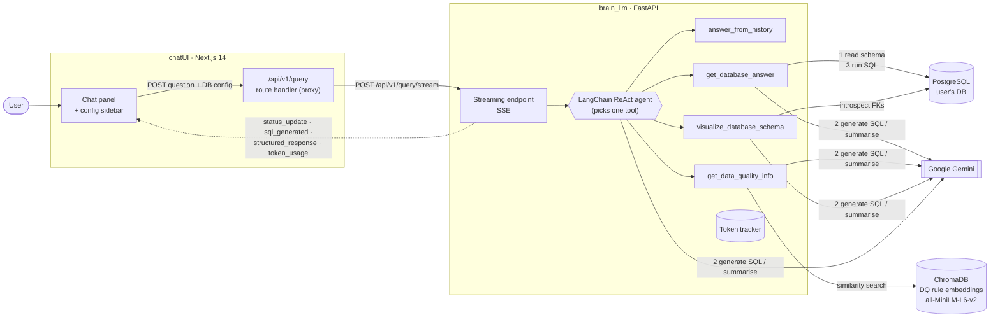
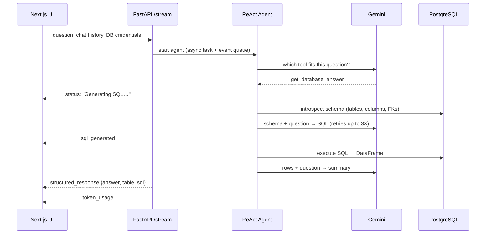

# Brain LLM — Ask Your Postgres Database in Plain English

A chat interface that turns natural-language questions into SQL, runs them against a live PostgreSQL database, and streams back a readable answer, the result table, and the SQL it wrote. It can also draw an interactive graph of the database schema and look up relevant data-quality rules with semantic search.

<!-- TODO(aryan): one line of context, e.g. "Built at <event/company>, 2025" -->

<!-- DEMO_GIF -->
> 🎬 Demo GIF coming soon (`docs/demo.gif`)

---

## What it does

| Ask something like… | The agent picks… | You get back |
|---|---|---|
| *"Top 5 customers by total invoice amount"* | `get_database_answer` | Generated SQL → executed → table + plain-English summary |
| *"Show me how the tables are related"* | `visualize_database_schema` | Interactive node/edge graph of the central tables (vis-network) |
| *"What data-quality checks apply to customer master data?"* | `get_data_quality_info` | Matching rules from a ~570-rule SAP data-quality rulebook, each with a generated validation query |
| *"What did I just ask you?"* | `answer_from_history` | A conversational reply that uses the chat history |

Every step streams to the UI while it happens (*Generating SQL… → Executing query… → Interpreting results…*), and a sidebar shows how many tokens each request used.

You can point it at **any Postgres database** from the UI. It reads that database's schema and uses it as the context for SQL generation.

---

## Architecture



### How a question becomes an answer (`get_database_answer`)



### Key design decisions

- **Server-Sent Events over WebSockets.** Data only flows server→client during a request, so SSE is enough. It also passes cleanly through the Next.js route handler. Each agent tool pushes events to an `asyncio.Queue`, and the HTTP response drains that queue.
- **The agent stops after one tool.** A custom `StopAfterToolOutputParser` ends the ReAct loop as soon as a tool has sent its structured result. This prevents the model from looping or rewriting an answer that is already correct, and it saves tokens.
- **Schema read on demand, not hardcoded.** The backend introspects whatever database the user connects to. A schema can also be sent with the request to skip introspection on large databases.
- **Pluggable LLM layer.** `BaseLLMService` plus a factory picks the provider from the model-name prefix (`gemini-*`). An API key passed with a request overrides the server's key for that request only.
- **Token accounting per request.** A request-scoped tracker adds up usage across every LLM call (routing, SQL, summary) and reports one total to the UI.

---

## Tech stack

| Layer | Tech |
|---|---|
| Frontend | Next.js 14 (App Router), React 18, Tailwind, Radix UI, GSAP animations, vis-network |
| Backend | FastAPI, LangChain (ReAct agent), Pydantic Settings |
| LLM | Google Gemini via `langchain-google-genai` / `google-generativeai` |
| Data | PostgreSQL (psycopg2 + SQLAlchemy pooling), pandas |
| Semantic search | ChromaDB + sentence-transformers `all-MiniLM-L6-v2` |

---

## Run it locally

**Prerequisites:** Python 3.11–3.13 (torch has no wheels for newer versions yet), Node 18+, a PostgreSQL database, and a [Gemini API key](https://aistudio.google.com/apikey).

Any Postgres database works. For a quick demo, load the [Chinook sample database](https://github.com/lerocha/chinook-database) (music store: artists, albums, invoices).

### 1. Backend

```bash
cd brain_llm
python -m venv .venv && source .venv/bin/activate
pip install -r requirements.txt
cp .env.example .env          # add your Gemini key + DB details
uvicorn app.main:app --reload --port 8000
```

### 2. Frontend

```bash
cd chatUI
npm install
cp .env.example .env.local    # same Gemini key + DB details
npm run dev                   # http://localhost:3000
```

You can also enter the API key and database connection at runtime in the right-hand **Configuration** sidebar.

---

## Project structure

```
brain_llm/                  FastAPI backend
  app/
    api/v1/endpoints/       /query/stream (SSE), /generate
    services/
      langchain_service.py  ReAct agent + the four tools
      sql_query_router_logic.py   schema introspection, SQL gen/exec
      dq_rule_manager.py    ChromaDB-backed DQ rule search
      visualization_service.py    schema → graph JSON
      llm/                  provider abstraction (Gemini)
      token_tracker.py      per-request token accounting
  dqrules.csv               DQ rulebook (SAP master-data rules)
chatUI/                     Next.js frontend
  app/api/v1/query/         proxy route → backend SSE
  components/               chat panel, sidebars, table, schema graph
```

---

## Known limitations / what I'd do next

This was built fast, so here are the rough edges:

- **SQL safety.** Generated SQL runs on the connection you give it. Production would need a read-only DB role, a statement allow-list (SELECT only, enforced by parsing, not a prefix check), and `statement_timeout`.
- **Prompt-stuffed schema.** The whole schema goes into the prompt. That works for Chinook-sized databases, but on large ones it should retrieve only the relevant tables (embed table/column descriptions and fetch the top-k).
- **No evaluation set.** Next step would be a small benchmark of question → expected-result pairs (Spider-style) so prompt changes can be measured, not eyeballed.
- **Credentials pass through the client.** DB credentials travel in the request body. A real deployment would keep saved connections on the server, behind auth.
- **Unused UI components.** Several superseded component variants (`*_old`, `*_New`, `*_Working`) are still in the tree.

More detail: [`PRODUCT_DOCUMENTATION.md`](PRODUCT_DOCUMENTATION.md), [`brain_llm/SYSTEM_ARCHITECTURE.md`](brain_llm/SYSTEM_ARCHITECTURE.md), [`INTEGRATION_GUIDE.md`](INTEGRATION_GUIDE.md).
