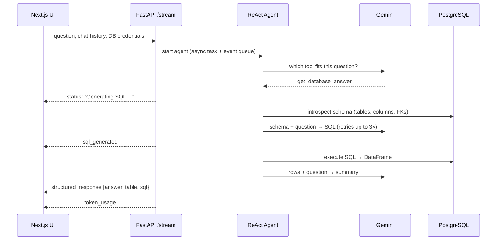

<!-- Cards are generated: see repo-docs-pipeline/design/cards.py -->

<picture>
  <source media="(prefers-color-scheme: dark)" srcset="docs/assets/hero-dark.svg"/>
  
</picture>

<p align="center">
  <a href="#-see-it-work"><b>Demo</b></a> &nbsp;·&nbsp;
  <a href="#-how-it-works"><b>Architecture</b></a> &nbsp;·&nbsp;
  <a href="#-run-it"><b>Run it</b></a> &nbsp;·&nbsp;
  <a href="#-what-id-do-next"><b>What I'd do next</b></a>
</p>

<!-- TODO(aryan): one line of context, e.g. "Built at <event/company>, 2025" -->

## ▸ See it work

<!-- DEMO_GIF -->
<p align="center"><sub><i>Demo recording coming soon.</i></sub></p>

## ▸ What you can ask

<table>
<tr>
<td width="50%" valign="top">

<sub>01 · DATA</sub>
### Ask a question about your data
*"Top 5 customers by total invoice amount"*

The agent writes PostgreSQL for your schema, runs it, and returns a plain-English answer, the result table, and the SQL itself so you can check it.

<sub>`get_database_answer`</sub>

</td>
<td width="50%" valign="top">

<sub>02 · SCHEMA</sub>
### See how the tables connect
*"Show me how the tables are related"*

It reads the foreign keys and draws an interactive graph of the most connected tables. You can drag it and switch layouts.

<sub>`visualize_database_schema` · vis-network</sub>

</td>
</tr>
<tr>
<td width="50%" valign="top">

<sub>03 · DATA QUALITY</sub>
### Find the right data-quality checks
*"What checks apply to customer master data?"*

It runs a semantic search over a ~570-rule SAP data-quality rulebook and writes a validation query for each match.

<sub>`get_data_quality_info` · ChromaDB</sub>

</td>
<td width="50%" valign="top">

<sub>04 · CONVERSATION</sub>
### Keep the context
*"What did I just ask you?"*

It answers follow-ups and small talk from the chat history, without querying the database.

<sub>`answer_from_history`</sub>

</td>
</tr>
</table>

Each step streams live to the UI (*Generating SQL… → Executing query… → Interpreting results…*), and a sidebar adds up the tokens every request used. You can point it at **any Postgres database** from the settings panel.

## ▸ How it works

<picture>
  <source media="(prefers-color-scheme: dark)" srcset="docs/assets/architecture-dark.svg"/>
  
</picture>

<picture>
  <source media="(prefers-color-scheme: dark)" srcset="docs/assets/flow-dark.svg"/>
  
</picture>

### Decisions worth talking about

| | Decision | Why |
|---|---|---|
| **01** | **Server-Sent Events, not WebSockets** | Data only flows server → client during a request. SSE is plain HTTP, so it passes cleanly through the Next.js route handler. |
| **02** | **The agent stops after one tool** | A custom `StopAfterToolOutputParser` ends the ReAct loop as soon as a tool has sent its result. This stops the model from looping or rewriting a correct answer, and it saves tokens. |
| **03** | **Schema read at runtime, not hardcoded** | The backend introspects whatever database you connect, so it isn't tied to one demo database. You can also send a schema with the request to skip introspection on large databases. |
| **04** | **Pluggable LLM layer** | `BaseLLMService` plus a factory picks the provider from the model-name prefix. An API key sent with a request overrides the server's key for that request only. |
| **05** | **Token accounting per request** | A request-scoped tracker adds up usage across every LLM call (routing, SQL, summary) and reports one total. |

<details>
<summary><b>Request sequence (detailed)</b></summary>



</details>

## ▸ Built with

<table>
<tr>
<td valign="top"><sub>FRONTEND</sub><br/><b>Next.js 14</b> · React 18 · Tailwind · Radix UI · GSAP · vis-network</td>
<td valign="top"><sub>BACKEND</sub><br/><b>FastAPI</b> · LangChain (ReAct) · Pydantic Settings</td>
</tr>
<tr>
<td valign="top"><sub>MODELS</sub><br/><b>Google Gemini</b> · sentence-transformers <code>all-MiniLM-L6-v2</code></td>
<td valign="top"><sub>DATA</sub><br/><b>PostgreSQL</b> · psycopg2 · SQLAlchemy · pandas · ChromaDB</td>
</tr>
</table>

## ▸ Run it

You need Python 3.11–3.13 (torch has no wheels for newer versions yet), Node 18+, a PostgreSQL database, and a [Gemini API key](https://aistudio.google.com/apikey). Any Postgres database works. The [Chinook sample](https://github.com/lerocha/chinook-database) (a music store) is a good one to try.

```bash
# 1 · backend  → http://localhost:8000
cd brain_llm
python -m venv .venv && source .venv/bin/activate
pip install -r requirements.txt
cp .env.example .env            # Gemini key + DB details
uvicorn app.main:app --reload --port 8000

# 2 · frontend → http://localhost:3000
cd chatUI
npm install
cp .env.example .env.local      # same key + DB details
npm run dev
```

You can also set the API key and database connection at runtime in the **Configuration** sidebar.

<details>
<summary><b>Project structure</b></summary>

```
brain_llm/                        FastAPI backend
  app/
    api/v1/endpoints/             /query/stream (SSE), /generate
    services/
      langchain_service.py        ReAct agent + the four tools
      sql_query_router_logic.py   schema introspection, SQL gen/exec
      dq_rule_manager.py          ChromaDB-backed DQ rule search
      visualization_service.py    schema → graph JSON
      llm/                        provider abstraction (Gemini)
      token_tracker.py            per-request token accounting
  dqrules.csv                     DQ rulebook (SAP master-data rules)
chatUI/                           Next.js frontend
  app/api/v1/query/               proxy route → backend SSE
  components/                     chat panel, sidebars, table, schema graph
```

</details>

## ▸ What I'd do next

This was built fast. These are the rough edges I'd fix first:

- **SQL safety.** Generated SQL runs on the connection you give it. Production would need a read-only DB role, SELECT-only enforced by parsing (not a prefix check), and a `statement_timeout`.
- **Schema size.** The whole schema goes into the prompt. That's fine for Chinook-sized databases, but large ones need retrieval: embed table/column descriptions and fetch only the top-k relevant ones.
- **Evaluation.** Add a small question → expected-result benchmark (Spider-style) so prompt changes can be measured, not eyeballed.
- **Credentials.** DB credentials currently travel in the request body. A real deployment would store connections on the server, behind auth.
- **Cleanup.** A few superseded UI component variants (`*_old`, `*_New`, `*_Working`) are still in the tree.

<sub>More detail: [`PRODUCT_DOCUMENTATION.md`](PRODUCT_DOCUMENTATION.md) · [`brain_llm/SYSTEM_ARCHITECTURE.md`](brain_llm/SYSTEM_ARCHITECTURE.md) · [`INTEGRATION_GUIDE.md`](INTEGRATION_GUIDE.md)</sub>

<p align="center"><sub>Part of <a href="https://github.com/Aryan-yadav15">Aryan Yadav's work</a>.</sub></p>
