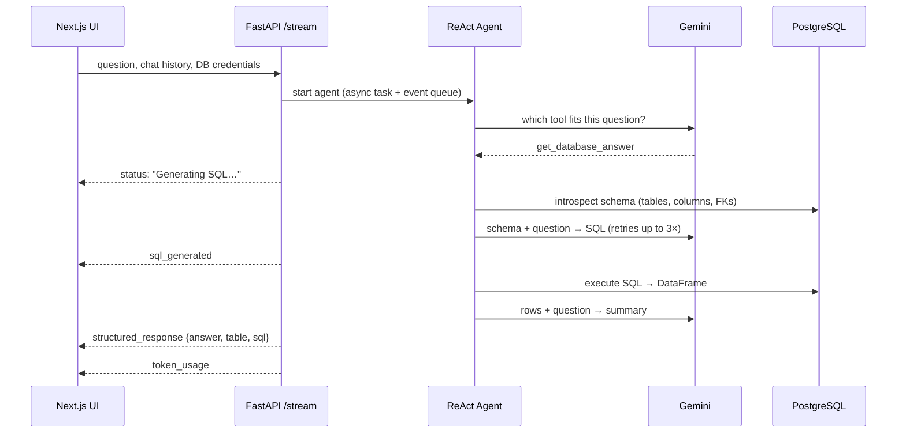

<!-- Cards are generated: see repo-docs-pipeline/design/cards.py -->

<picture>
  <source media="(prefers-color-scheme: dark)" srcset="docs/assets/hero-dark.svg"/>
  
</picture>

<p align="center">
  <a href="#-see-it-work"><b>Demo</b></a> &nbsp;·&nbsp;
  <a href="#-how-it-works"><b>Architecture</b></a> &nbsp;·&nbsp;
  <a href="#-run-it"><b>Run it</b></a> &nbsp;·&nbsp;
  <a href="#-what-id-do-next"><b>What I'd do next</b></a>
</p>

<!-- TODO(aryan): one line of context, e.g. "Built at <event/company>, 2025" -->

## ▸ See it work

<!-- DEMO_GIF -->
<p align="center"><sub><i>Demo recording coming soon.</i></sub></p>

<picture>
  <source media="(prefers-color-scheme: dark)" srcset="docs/assets/capabilities-dark.svg"/>
  
</picture>

Each step streams live to the UI (*Generating SQL… → Executing query… → Interpreting results…*), and a sidebar adds up the tokens every request used. You can point it at **any Postgres database** from the settings panel.

## ▸ How it works

<picture>
  <source media="(prefers-color-scheme: dark)" srcset="docs/assets/architecture-dark.svg"/>
  
</picture>

<picture>
  <source media="(prefers-color-scheme: dark)" srcset="docs/assets/flow-dark.svg"/>
  
</picture>

<picture>
  <source media="(prefers-color-scheme: dark)" srcset="docs/assets/decisions-dark.svg"/>
  
</picture>

<picture>
  <source media="(prefers-color-scheme: dark)" srcset="docs/assets/editor-dark.svg"/>
  
</picture>

<details>
<summary><b>Request sequence (detailed)</b></summary>



</details>

## ▸ Built with

<picture>
  <source media="(prefers-color-scheme: dark)" srcset="docs/assets/stack-dark.svg"/>
  
</picture>

## ▸ Run it

You need Python 3.11–3.13 (torch has no wheels for newer versions yet), Node 18+, a PostgreSQL database, and a [Gemini API key](https://aistudio.google.com/apikey). Any Postgres database works. The [Chinook sample](https://github.com/lerocha/chinook-database) (a music store) is a good one to try.

<picture>
  <source media="(prefers-color-scheme: dark)" srcset="docs/assets/terminal-dark.svg"/>
  
</picture>

<details>
<summary><b>Copy the commands</b></summary>

```bash
# 1 · backend  → http://localhost:8000
cd brain_llm
python -m venv .venv && source .venv/bin/activate
pip install -r requirements.txt
cp .env.example .env            # Gemini key + DB details
uvicorn app.main:app --reload --port 8000

# 2 · frontend → http://localhost:3000
cd chatUI
npm install
cp .env.example .env.local      # same key + DB details
npm run dev
```

</details>

You can also set the API key and database connection at runtime in the **Configuration** sidebar.

<details>
<summary><b>Project structure</b></summary>

```
brain_llm/                        FastAPI backend
  app/
    api/v1/endpoints/             /query/stream (SSE), /generate
    services/
      langchain_service.py        ReAct agent + the four tools
      sql_query_router_logic.py   schema introspection, SQL gen/exec
      dq_rule_manager.py          ChromaDB-backed DQ rule search
      visualization_service.py    schema → graph JSON
      llm/                        provider abstraction (Gemini)
      token_tracker.py            per-request token accounting
  dqrules.csv                     DQ rulebook (SAP master-data rules)
chatUI/                           Next.js frontend
  app/api/v1/query/               proxy route → backend SSE
  components/                     chat panel, sidebars, table, schema graph
```

</details>

## ▸ What I'd do next

This was built fast. These are the rough edges I'd fix first:

- **SQL safety.** Generated SQL runs on the connection you give it. Production would need a read-only DB role, SELECT-only enforced by parsing (not a prefix check), and a `statement_timeout`.
- **Schema size.** The whole schema goes into the prompt. That's fine for Chinook-sized databases, but large ones need retrieval: embed table/column descriptions and fetch only the top-k relevant ones.
- **Evaluation.** Add a small question → expected-result benchmark (Spider-style) so prompt changes can be measured, not eyeballed.
- **Credentials.** DB credentials currently travel in the request body. A real deployment would store connections on the server, behind auth.
- **Cleanup.** A few superseded UI component variants (`*_old`, `*_New`, `*_Working`) are still in the tree.

<sub>More detail: [`PRODUCT_DOCUMENTATION.md`](PRODUCT_DOCUMENTATION.md) · [`brain_llm/SYSTEM_ARCHITECTURE.md`](brain_llm/SYSTEM_ARCHITECTURE.md) · [`INTEGRATION_GUIDE.md`](INTEGRATION_GUIDE.md)</sub>

<p align="center"><sub>Part of <a href="https://github.com/Aryan-yadav15">Aryan Yadav's work</a>.</sub></p>
